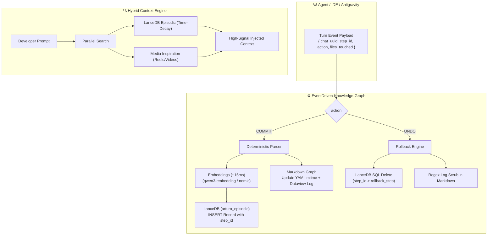

# 🧠 EventDriven-Knowledge-Graph

> **Deterministic Episodic Memory & Event-Driven Knowledge Graph for Autonomous AI Coding Agents.**  
> Powered by **LanceDB** (Embedded Vector Store) & **Obsidian/Markdown** (Zettelkasten / Dataview).

[](LICENSE)
[](https://nodejs.org/)
[](https://lancedb.github.io/lancedb/)
[]()

---

## 🎯 The Problem: Why Traditional RAG Fails Coding Agents

When autonomous AI agents (Antigravity, Claude, Cursor, Aider) work on complex multi-turn coding sessions:
1. **The LLM State Bottleneck:** Asking a local LLM to "summarize and structure database records" on every turn causes GPU queuing, hallucinations, slow round-trips (~3-10s), and broken JSON schemas.
2. **The "No-Undo" Poisoning:** Traditional RAG is append-only. If a developer uses `/undo`, reverts a git commit, or steps back in the chat trajectory, the vector database remains polluted with stale hallucinations and abandoned code snippets.
3. **Temporal Blindness:** Standard vector search only measures cosine similarity. An action taken 5 minutes ago on the current feature is treated with the same weight as an obsolete note from 6 months ago.

---

## ⚡ The Solution: Deterministic State + Perfect Undo

**EventDriven-Knowledge-Graph** solves this by decoupling cognition from state storage:

* **100% Deterministic Extraction:** Antigravity and the developer have *already* performed the cognitive work. The engine consumes the turn event payload (`chat_uuid`, `step_id`, `files_touched`, `user_prompt`, `assistant_summary`) directly via Node.js.
* **Vector Algebra Only:** Text embeddings are computed in ~15ms via local embedding endpoints (`qwen3-embedding:0.6b`), with zero LLM reasoning in the database path.
* **Mathematical Undo via `step_id`:** When an agent trajectory is rolled back to step $N$, the engine executes a deterministic deletion in LanceDB:
  ```sql
  DELETE FROM arturo_episodic WHERE chat_uuid = $uuid AND step_id > $rollback_step;
  ```
  and scrubs the equivalent entries from the Markdown knowledge graph.
* **Time-Decay Hybrid Retrieval:** Ranks facts using an exponential recency curve:
  $$\text{Score} = (0.50 \cdot \text{CosineSimilarity}) + \left(0.35 \cdot e^{-\lambda \cdot \Delta t_{\text{hours}}}\right) + (0.15 \cdot \text{Importance})$$
* **Media Cross-Pollination:** Ingests transcribed technical reels/videos into a `MEDIA_INSPIRATION` partition and auto-suggests relevant external ideas when cosine similarity $\ge 0.78$.

---

## 🏗️ Architecture



---

## 🚀 Quickstart

### 1. Installation

```bash
git clone https://github.com/guerrerotolozar/EventDriven-Knowledge-Graph.git
cd EventDriven-Knowledge-Graph
npm install
```

### 2. Configuration

Copy `.env.example` to `.env`:

```bash
cp .env.example .env
```

Ensure Ollama is running locally with your embedding model:
```bash
ollama pull qwen3-embedding:0.6b
```

### 3. Start the Service

```bash
npm run dev
```

---

## 📡 API Reference

### 1. Sync Turn Event (Commit / Undo)

* **Endpoint:** `POST /api/v1/memory/sync-turn`
* **Headers:** `Content-Type: application/json`, `x-arturo-key: <API_KEY>`

#### Commit Example:
```json
{
  "action": "COMMIT",
  "chat_uuid": "ea1b9a30-86b2-498b-b0e5-a3f72da18e52",
  "step_id": 14,
  "project_name": "OasisStore",
  "category": "OPERACIONES",
  "files_touched": ["webhook-service/main.py", "docker-compose.yml"],
  "user_prompt": "Configurar endpoint de webhooks para el catálogo.",
  "assistant_summary": "Se añadió endpoint /webhook y se expuso en el puerto 8000.",
  "importance": 0.8
}
```

#### Undo Example:
```json
{
  "action": "UNDO",
  "chat_uuid": "ea1b9a30-86b2-498b-b0e5-a3f72da18e52",
  "rollback_step": 10,
  "project_name": "OasisStore"
}
```

### 2. Retrieve Context (Time-Decay)

* **Endpoint:** `GET /api/v1/memory/context?query=como+configurar+webhooks&top_k=5`
* **Headers:** `x-arturo-key: <API_KEY>`

---

## 📂 Repository Structure

```text
EventDriven-Knowledge-Graph/
├── docs/
│   └── ARCHITECTURE.md          # Full technical specifications & schemas
├── src/
│   ├── config/                  # Environment variables loader
│   ├── controllers/             # Express thin controllers
│   ├── repositories/            # LanceDB vector repository & schema
│   ├── services/                # Episodic memory & Time-Decay retrieval
│   └── index.js                 # Microservice entry point
├── vault-template/              # Sample sanitized Markdown Knowledge Graph
│   ├── NUCLEO/                  # Agent protocols & cognitive architecture
│   ├── OPERACIONES/             # Tech lab & infrastructure notes
│   └── 000 - Índice Maestro.md  # Obsidian Dataview master index
├── .env.example
├── .gitignore                   # Rigorously protects private vaults
├── package.json
└── README.md
```

---

## 🔒 Security & Privacy

* Real personal vaults (`Boveda/`, `Boveda_AI/`) and SQLite/LanceDB binaries are strictly ignored via `.gitignore`.
* The included `vault-template/` directory contains only generic technical templates and architecture guidelines, ensuring zero leaks of personal or financial data.

---

## 👨‍💻 Author

Developed with passion by **Ronald Guerrero**.  
Designed for next-generation local AI agents and autonomous self-evolving second brains.
