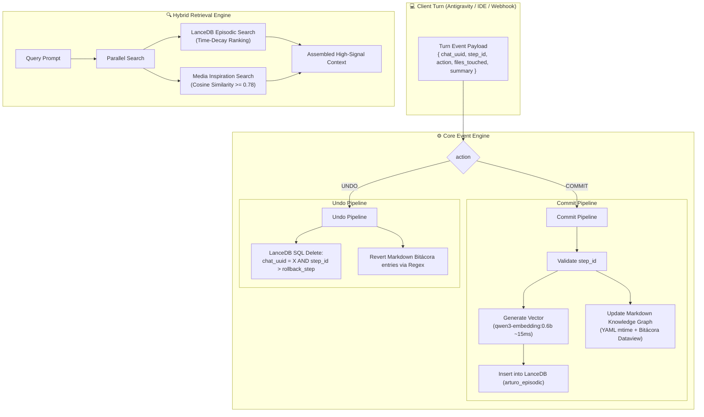

# 🏛️ Architecture: Event-Driven Knowledge Graph & Episodic Memory

> **System:** Event-Driven Knowledge Graph with Deterministic State, Undo Capability & Time-Decay Retrieval  
> **Target:** Local AI Agent Orchestration (Antigravity / Claude / Cursor / Headless Agents)  
> **Storage:** LanceDB (Embedded Vector Store) + Obsidian/Markdown (Human-Readable Knowledge Graph)  
> **Philosophy:** Zero LLM hallucinations in database writes. Deterministic event extraction + Linear algebra (embeddings) + Mathematical time-decay.

---

## 1. Core Motivation

When AI coding assistants interact with persistent agent backends or Second Brains, two major architectural failures occur:
1. **The LLM Bottleneck:** Relying on a local LLM (Ollama 8B/14B) to summarize, decide schemas, and insert records into a database causes high GPU latency, hallucinations, schema corruption, and OOM issues.
2. **Loss of Session State (No Undo):** Traditional RAG treats knowledge as an append-only blob. When a developer rolls back a git commit, reverts a prompt turn, or branches an agent conversation, the vector database remains dirty with stale hallucinations.

**EventDriven-Knowledge-Graph** solves this with an **Event-Driven, Deterministic State Architecture**:
* Antigravity and the developer have already solved the cognitive task.
* The API receives exact metadata from the turn (`chat_uuid`, `step_id`, `files_touched`, `user_prompt`, `assistant_summary`).
* State mutations are deterministic code. Vectorization uses lightweight embedding models (~15ms).
* Complete state reversion (**Undo**) is mathematically guaranteed by `step_id`.

---

## 2. System Architecture

---

## 3. LanceDB Episodic Schema

The `arturo_episodic` table schema:

| Field | Type | Description |
| :--- | :--- | :--- |
| `id` | `string` (UUID v4) | Primary key |
| `vector` | `float32[]` | Dense vector embedding (1024 or 768 dim) |
| `fact_text` | `string` | High-signal summary of the action/decision |
| `category` | `string` (Enum) | `OPERACIONES`, `NUCLEO`, `VIDA`, `MEDIA_INSPIRATION` |
| `project_name` | `string` | Name of the active repository or module |
| `chat_uuid` | `string` | Conversation or session UUID |
| `step_id` | `int32` | **Critical for Undo:** Sequential technical turn index |
| `created_at` | `string` (ISO-8601) | Timestamp of execution |
| `importance` | `float32` | Priority weight (0.1 - 1.0) |
| `files_touched` | `string` | Comma-separated list of modified files |

---

## 4. Time-Decay Retrieval Algorithm

Standard RAG ranks solely by cosine similarity. However, an action taken 5 minutes ago in the current session is vastly more relevant than an action taken 3 months ago on an unrelated repository.

We compute the hybrid ranking in JavaScript:

$$\text{Score} = (w_1 \cdot \text{CosineSimilarity}) + \left(w_2 \cdot e^{-\lambda \cdot \Delta t_{\text{hours}}}\right) + (w_3 \cdot \text{Importance})$$

* $w_1 = 0.50$, $w_2 = 0.35$, $w_3 = 0.15$
* $\lambda = 0.02$ (half-life of ~34 hours)
* $\Delta t_{\text{hours}} = \frac{\text{now} - \text{created\_at}}{3,600,000}$

---

## 5. Media & Cross-Pollination Engine

When users ingest multimedia references (e.g. Instagram Reels, YouTube lectures, architecture diagrams), the videos are transcribed and embedded under `category: MEDIA_INSPIRATION`.

During retrieval:
* A parallel query searches the media subset.
* If $\text{CosineSimilarity} \ge 0.78$, the system surfaces relevant video insights as actionable recommendations for the active project.
